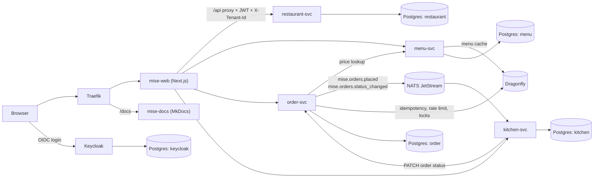

# Mise

Mise is a multi-tenant restaurant operations platform (menus, orders, kitchen tickets) built from FastAPI microservices and a Next.js web app; it is unrelated to the `mise` developer-tool version manager.

[](https://github.com/Fede-Berga/mise/actions/workflows/ci.yml)
[](LICENSE)


The MVP implements one workflow end to end: **order entry, kitchen ticketing, and two-way status synchronisation between orders and kitchen tickets**.

## Scope of the MVP

- Role-based web access for `owner`, `manager`, `chef`, `waiter` and `cashier`
- Menu management
- Order creation from the web app
- Kitchen tickets created automatically from order events
- Order and kitchen status kept in sync in both directions
- Tenant (restaurant) isolation through authenticated request forwarding

## Quick start

Prerequisites: Docker with Compose v2, `make`, about 8 GB of RAM for the core stack. For local development without Docker: Python 3.13 and Node.js 24.

```bash
cp .env.example .env
make up-core
```

`make up-core` builds the images and starts the core stack from [`infra/docker/docker-compose.core.yml`](infra/docker/docker-compose.core.yml). The Alembic migrations and the demo seed data run as one-shot containers before the services and the web app start; `make init-db` and `make seed` rerun them on their own.

| What | URL |
| --- | --- |
| Web app | http://localhost:3000 |
| Documentation site | http://localhost:3010 (or http://localhost/docs through Traefik) |
| Keycloak | http://localhost:8080/auth |
| Service health | http://localhost:8001/healthz to http://localhost:8004/healthz |

The imported Keycloak realm ([`infra/keycloak/mise-realm.json`](infra/keycloak/mise-realm.json)) defines one demo user per role. The role access matrix is in [`docs/getting-started/roles.md`](docs/getting-started/roles.md).

`make smoke-core` checks the health endpoints, the web app and the docs site; `make down` stops the stack.

## Architecture



- Each core service owns its database (one Postgres container per service) and its Alembic migrations. Shared code (settings, JWT validation, tenant dependency, NATS and Dragonfly helpers, health routes) lives in [`services/common`](services/common).
- The web app proxies `/api/<service>/...` to the services, adding the user's access token and the active restaurant as `X-Tenant-Id`. The services validate the JWT against Keycloak's signing keys, check the audience (`aud` or `azp`) and reject a tenant header that does not match the token.
- `order-svc` publishes `mise.orders.placed` and `mise.orders.status_changed`; `kitchen-svc` consumes both through durable JetStream consumers to create tickets and align their status. Ticket status changes go back to `order-svc` over HTTP.
- `order-svc` accepts an `Idempotency-Key` header, rate-limits order creation per tenant and caller, and serialises status updates with a short-lived lock, all backed by Dragonfly.

Repository layout: `services/` (backend services and shared code), `mise-web/` (Next.js 14 app), `infra/` (Compose files, Keycloak realm, scripts), `docs/` (MkDocs site, configured in [`mkdocs.yml`](mkdocs.yml)).

## Running the tests

```bash
make install-dev     # pip install -r services/common/requirements-dev.txt
make lint            # ruff check, per service
make format-check    # ruff format --check, per service
make test            # pytest, per service
make typecheck       # mypy (not yet clean; non-blocking in CI)
```

The backend suite is unit-level and needs no running infrastructure: JWT claim validation in `services/common`, menu caching in `menu-svc`, idempotency and status-update locking in `order-svc`, and status synchronisation in `kitchen-svc`. CI also runs `npm ci`, `npm run lint` and `npm run build` for `mise-web`. Before a release, the manual end-to-end checks in [`docs/qa/e2e-checklist.md`](docs/qa/e2e-checklist.md) cover login stability, the role matrix, order to ticket creation, status sync and restaurant switching.

The documentation site builds with `make install-docs` and `make docs-build` (or `make docs-serve` for live reload).

## Design decisions and limitations

- Only the four core services (restaurant, menu, order, kitchen) are wired into the core stack and covered by tests. The other services under `services/` and [`docker-compose.full.yml`](infra/docker/docker-compose.full.yml) (inventory, personnel, finance, notification, analytics, AI, hardware, plus MinIO, ClickHouse and Meilisearch) are not part of the core stack and have no migrations or tests.
- Tenant isolation is enforced in application code: repositories scope queries by `tenant_id`, and the tenant header must match the token. The migrations do not create Postgres row-level security policies.
- Events are published after the database write without an outbox, and publish failures are only logged, so an event can be lost.
- `make typecheck` currently reports mypy errors; CI runs it with `continue-on-error`.
- The Compose setup is for local development: Keycloak runs in `start-dev` mode, Traefik's dashboard is insecure, and the defaults in `.env.example` are development credentials.
- There is no web test suite yet; the web app is checked by lint and a production build.

Further documentation: [`docs/engineering/git-workflow.md`](docs/engineering/git-workflow.md), [`docs/contributing/extensibility.md`](docs/contributing/extensibility.md), [`docs/deployment/kind-rocky.md`](docs/deployment/kind-rocky.md).

## License

[GPL-3.0-only](LICENSE): GNU General Public License, version 3 only.
